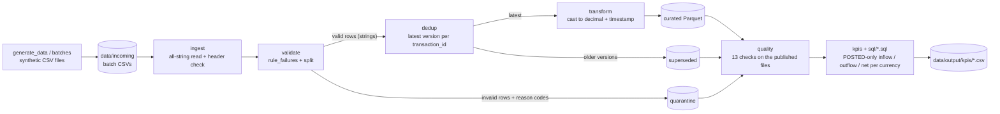
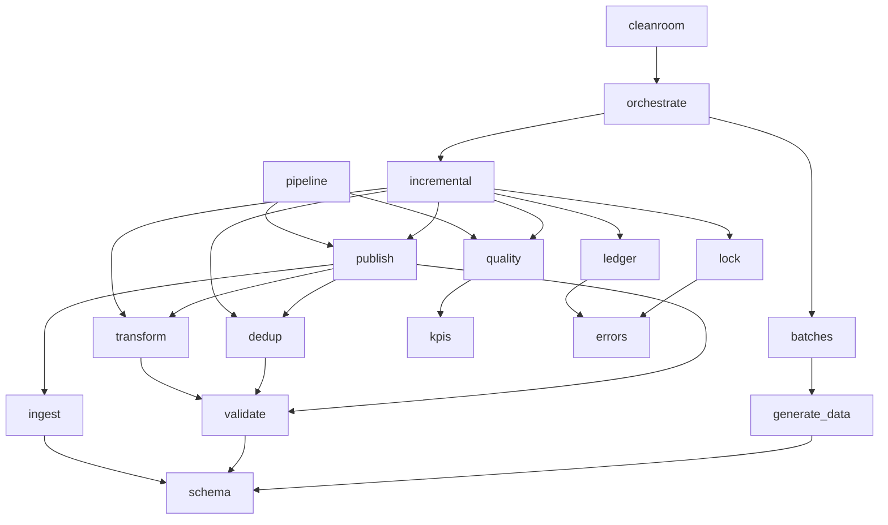
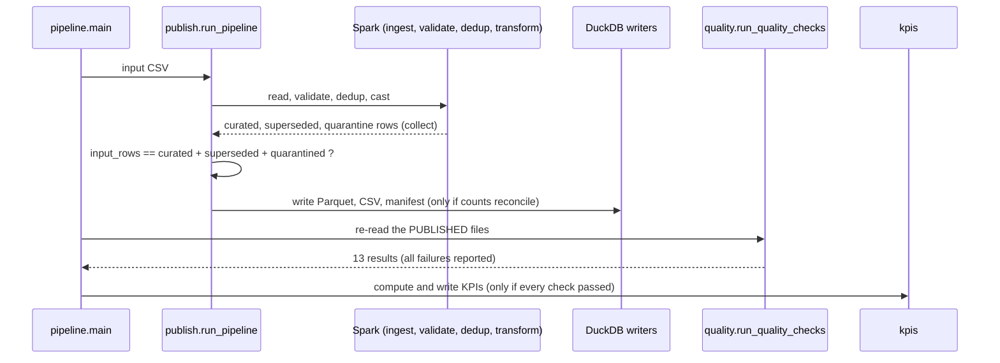
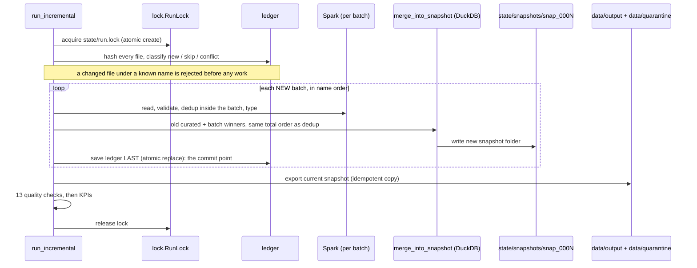
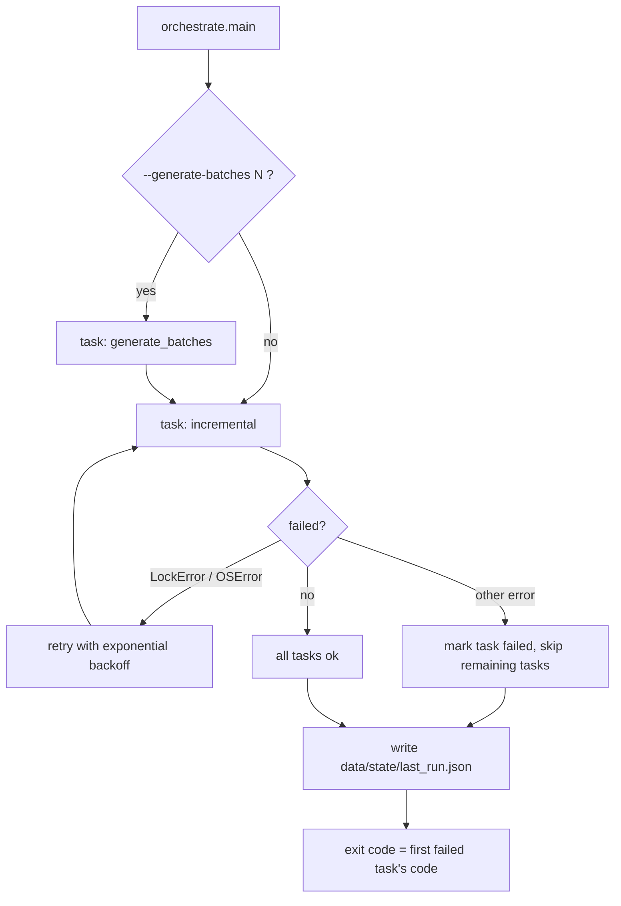

# Architecture

How the pipeline is built, how data flows between files, and which module calls which.
See `REFERENCE.md` for every file and function.

## 1. The idea in one picture

Raw CSV rows are read as strings, checked row by row, split into valid and quarantined,
deduplicated, typed, published, verified by independent checks, and summarised as KPIs.



## 2. Module dependencies

An arrow means "imports from". Low-level modules at the bottom know nothing about the ones above.
`config`, `errors` and `logging_setup` are used by the entry-point modules (`pipeline`,
`incremental`, `orchestrate`) and are left out of the picture to keep it readable.



Rule enforced by a test: production code never imports `generate_data`, except `batches.py`.
The data contract (`COLUMNS`, timestamp format, allowed values) lives only in `schema.py`.

## 3. What the data looks like at each stage

| Stage | Where | Shape |
|---|---|---|
| Raw | Spark DataFrame from `ingest.read_raw_transactions` | 8 string columns; an empty CSV field is `null`; bad values are untouched |
| Validated | `validate.rule_failures` | raw columns + `quarantine_reasons` (`array<string>`, empty = valid) |
| Valid / quarantine | `validate.split_valid_quarantine` | valid: 8 string columns; quarantine: 8 columns + reasons |
| Latest / superseded | `dedup.dedup_transactions` | 8 string columns each; `latest + superseded == valid` |
| Curated | `transform.cast_to_curated` | `amount` is `decimal(18,2)`, the two timestamps are `timestamp`, the rest strings |
| Published | `publish` (DuckDB writers) | Parquet for curated and superseded, CSV for quarantine (reasons joined with `;`), `manifest.json` |
| Snapshot | `incremental.merge_into_snapshot` | `curated.parquet`, `superseded.parquet`, `quarantine.csv` (+ `batch_id`), `manifest.json` |

Why strings first: a typed reader would turn `not-a-timestamp` into `null` before validation could
see it. Casting happens only after validation and dedup, with a safeguard that raises if any cast
would produce a null.

## 4. One-shot run (`pipeline.py`)



## 5. Incremental run (`incremental.py`)

New batch files in `data/incoming` are merged into the existing state without reprocessing old data.



Why the ledger is written last: if it were written first and the process crashed, the batch would
be marked done but its data would never have been published. Written last, a crash just means the
batch is retried from the previous snapshot. Orphan snapshot folders are deleted on the next run.

How a late-arriving version is handled:

| New batch contains | Result |
|---|---|
| A new `transaction_id` | goes to curated |
| A newer version of an existing id | becomes curated; the old curated row moves to superseded |
| An older version of an existing id | goes straight to superseded; curated unchanged |
| Same timestamp as the current winner | deterministic tie-break (status, amount, account, ...) |
| An invalid row | quarantined, tagged with the batch file name |

## 6. Orchestration and failure handling



| Exit code | Meaning | Raised as |
|---|---|---|
| 0 | success | |
| 1 | a data-quality check failed | `QualityCheckError` |
| 2 | bad input or configuration | `ValueError`, `FileNotFoundError` |
| 3 | a batch file changed after it was processed | `BatchConflictError` |
| 4 | another run holds `state/run.lock` | `LockError` |

The mapping lives in one place: `errors.exit_code_for`.

## 7. Where files live on disk

```text
data/
  sample/transactions.csv          generated sample (seed 42, 1000 rows)
  incoming/                        batch CSVs waiting to be processed
  state/
    ledger.json                    processed batches (name, SHA-256, rows, snapshot)
    run.lock                       exists only while a run is active
    last_run.json                  orchestrator run log
    snapshots/snap_0001 ...        one folder per processed batch (audit trail)
  output/
    curated/transactions.parquet
    superseded/superseded.parquet
    manifest.json                  input = curated + superseded + quarantined
    kpis/*.csv                     totals, daily, by_account, status_summary
  quarantine/quarantine.csv        rejected rows + reason codes (+ batch_id when incremental)
```

## 8. Design decisions that shape the architecture

- **Validate before dedup:** an invalid row must never win a "latest version" contest.
- **Collect all failed rules per row:** first-fail hides problems.
- **Null-safe rules:** `NULL IN (...)` is `NULL`, so every rule is coalesced to true/false and the
  split uses `size(reasons) == 0`; nothing can fall out of both outputs.
- **Reconcile before writing:** a count mismatch raises and nothing is published.
- **Checks read the published files:** a corrupted write cannot hide behind in-memory DataFrames,
  and the manifest is cross-checked rather than trusted.
- **Money as decimals:** integer cents in the generator, `DECIMAL` in Spark and DuckDB.
- **Spark for typing, DuckDB for writing:** files are written with DuckDB after `collect()`. This
  suits thousands of rows, not billions (see the measured scale results in the README).

## 9. Test architecture

- Spark tests share one session through a session-scoped fixture in `tests/conftest.py`; every test
  that uses it is auto-marked `slow`, so `pytest -m "not slow"` is a fast loop.
- Test data is written as small CSV files and read through the real ingestion path.
- Independent oracles (plain Python) re-derive validity, dedup and KPIs, so tests do not check the
  implementation against itself.
- Corruption tests break one thing in a copy of the output and assert that the matching check fails.
